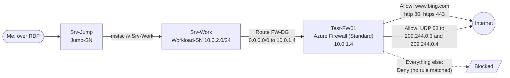

# Azure Firewall Lab: Controlling Outbound Traffic with Default-Deny Rules

Hands-on Azure cloud security lab (AZ-500 style, resource group `AZ500LAB08`). I deployed **Azure Firewall**, forced a workload subnet's outbound traffic through it with a custom route, allowed only `www.bing.com` plus two DNS servers, and tested that everything else was denied.

This repository lab is the **technical walkthrough**: exact settings, troubleshooting, results and hardening notes. The narrative write-up is on Medium: **https://medium.com/@elizabethsesebor169**


---

## Table of contents

1. Objectives
2. Architecture
3. Prerequisites
4. Walkthrough
5. Results
6. Troubleshooting
7. Security observations and hardening
8. Compliance mapping
9. Cleanup
10. Disclaimer

---

## 1. Objectives

- Create a virtual network with a **workload subnet** and a **jump host subnet**
- Deploy a **virtual machine in each subnet**
- Create a **custom route** forcing all outbound traffic from the workload subnet through the firewall
- Create **application rules** allowing outbound traffic only to `www.bing.com`
- Create **network rules** allowing external DNS lookups
- Test that allowed traffic works and everything else is denied

## 2. Architecture



| Resource | Name | Notes |
|---|---|---|
| Resource group | `AZ500LAB08` | Region: East US |
| Virtual network | `TEST-FW-VN` | Contains workload, jump and firewall subnets |
| Jump host VM | `Srv-Jump` | Entry point over RDP |
| Workload VM | `Srv-Work` | Subnet `Workload-SN`, `10.0.2.0/24` |
| Firewall | `Test-FW01` | Standard SKU, private IP `10.0.1.4` |
| Firewall public IP | `TEST-FW-PIP` | Standard, static |
| Route table | `Firewall-route` | Associated with `Workload-SN` |
| Route | `FW-DG` | `0.0.0.0/0` to virtual appliance `10.0.1.4` |

## 3. Prerequisites

- An Azure subscription with permission to create resources
- Access to the Azure portal
- The lab's ARM template (see [Troubleshooting](#6-troubleshooting) if it is not downloadable)
- A Remote Desktop client

## 4. Walkthrough

All steps are done in the Azure portal.

### Task 1: Deploy the lab environment from a template

1. In the portal search bar, enter **deploy a custom template**.
2. Select **Build your own template in the editor**, click **Load file**, and upload the template (`AZ500LAB08-template-revised.json`). Save.
3. Variables in the template: VNet name `TEST-FW-VN`, jump VM `Srv-Jump`, work VM `Srv-Work`, jump subnet `Jump-SN`.
4. Create a new resource group named **`AZ500LAB08`**.
5. Enter an admin password (use a strong one) and change the VM size to **`D2s_v4`** (see [Troubleshooting](#6-troubleshooting)).
6. Click **Review + create**, then **Create**.

Result: `Srv-Jump`, `Srv-Work` and their dependencies are deployed.

!Loading Template 
!Custom deployment settings 
!Template deployed 

### Task 2: Deploy Azure Firewall

Search for **Firewalls**, click **Create**, and use:

| Setting | Value |
|---|---|
| Resource group | `AZ500LAB08` |
| Name | `Test-FW01` |
| Region | East US |
| Firewall SKU | Standard |
| Firewall management | Use Firewall rules (classic) to manage this firewall |
| Virtual network | Use existing: `Test-FW-VN` |
| Firewall Management NIC | Disabled (deselect "Enable Firewall Management NIC") |
| Public IP address | Add new: `TEST-FW-PIP` |

Click **Review + create**, then **Create**.

!Create a firewall 

!Firewall deployed 


### Task 3: Create the default route

1. Search **Route table**, click **Create**. Resource group `AZ500LAB08`, region East US, name **`Firewall-route`**. Review + create, then Create.
2. Open `Firewall-route` > **Settings** > **Subnets** > **+ Associate**. Virtual network `Test-FW-VN`, subnet **`Workload-SN`**.
3. Open `Test-FW01` in the resource group and copy its **private IP address** (`10.0.1.4`).
4. Back on `Firewall-route` > **Settings** > **Routes** > **+ Add**:

| Setting | Value |
|---|---|
| Route name | `FW-DG` |
| Destination type | IP Address |
| Destination IP addresses/CIDR ranges | `0.0.0.0/0` |
| Next hop type | Virtual appliance |
| Next hop address | `10.0.1.4` |

!Firewall private IP 

!Add route FW-DG 


### Task 4: Application rule (allow `www.bing.com`)

On `Test-FW01` > **Settings** > **Rules (classic)** > **Application rule collection** > **+ Add application rule collection**:

| Setting | Value |
|---|---|
| Collection name | `App-Coll01` |
| Priority | `200` |
| Action | Allow |
| Rule name | `AllowGH` |
| Source type / Source | IP Address / `10.0.2.0/24` |
| Protocol:Port | `http:80, https:443` |
| Target FQDNs | `www.bing.com` |


!Application rule 


### Task 5: Network rule (allow DNS)

On `Test-FW01` > **Rules (classic)** > **Network rule collection** > **+ Add network rule collection**:

| Setting | Value |
|---|---|
| Collection name | `Net-Coll01` |
| Priority | `200` |
| Action | Allow |
| Rule name | `AllowDNS` |
| Protocol | UDP |
| Source type / Source | IP address / `10.0.2.0/24` |
| Destination type | IP address |
| Destination addresses | `209.244.0.3, 209.244.0.4` |
| Destination ports | `53` |

The destination addresses are well-known public DNS servers.

!Network rule 


### Task 6: Set custom DNS servers on the workload VM

This step is not a firewall requirement, but it makes `Srv-Work` use the DNS servers the firewall allows.

1. `AZ500LAB08` > `Srv-Work` > **Networking** > **Network settings** > **Network interface**, then open the `srv-work` NIC link.
2. **Settings** > **DNS servers** > **Custom**. Add `209.244.0.3` and `209.244.0.4`. Click **Apply**.

> Changing a NIC's DNS servers **restarts the attached VM** (and, where applicable, other VMs in the same availability set). Wait for the update to finish.

!Custom DNS servers 


### Task 7: Test the firewall

1. In `AZ500LAB08`, open `Srv-Jump` > **Connect** > **Connect**. Download the RDP file and sign in as `localadmin` with the password from Task 1.
2. Inside the `Srv-Jump` session, right-click **Start** > **Run** and enter:

   ```text
   mstsc /v:Srv-Work
   ```

3. Sign in to `Srv-Work` with the same credentials.
4. In `Srv-Work`, open **Server Manager** > **Local Server** > **IE Enhanced Security Configuration** and set both options to **Off** (for testing only).
5. Open Internet Explorer and browse to `https://www.bing.com`.
6. Then browse to `http://www.microsoft.com`.

## 5. Results

| Test | Expected | Result |
|---|---|---|
| `https://www.bing.com` from `Srv-Work` | Allowed by application rule | Page loaded with its search bar |
| `http://www.microsoft.com` from `Srv-Work` | Denied (no matching rule) | **Action: Deny. No rule matched. Proceeding with default action.** |

!Bing allowed 

!Microsoft denied 


The firewall was never told to block Microsoft. It blocked it because nothing allowed it, which is the point of default deny.

## 6. Troubleshooting

| Problem | Cause | What I did |
|---|---|---|
| Lab template (`template.json`) not downloadable | File unavailable from the lab source | I researched and found a near match on GitHub. Refined it with an AI tool to include its variables and dependencies, then deployed it as `AZ500LAB08-template-revised.json` |
| Default VM size not usable | The default is a newer size that supports only **Generation 2** (UEFI boot) VMs, while my hypervisor is **Generation 1** (BIOS boot) | Selected **`D2s_v4`** instead |
| VM restarted unexpectedly | Changing NIC DNS servers restarts the VM | Expected behaviour. Wait for the update to finish before testing |

## 7. Security observations and hardening

This lab takes shortcuts that are fine for learning but not for production:

| Observation | Why it matters | Better practice |
|---|---|---|
| IE Enhanced Security Configuration turned off on `Srv-Work` | Removes a browser protection layer | Turn it back on after testing |
| RDP used to reach the jump host | Exposed remote access is a common attack path | Use **Azure Bastion** or **just-in-time VM access**; restrict the source IPs |
| No firewall logging configured | Denied traffic is invisible | Send firewall diagnostics to **Log Analytics** and alert on denies |
| Classic rule collections | Harder to manage at scale | Use a **Firewall Policy** |
| Standard SKU | No TLS inspection or intrusion detection | Consider **Premium** if the threat model needs it |
| Rule named `AllowGH` for a Bing rule | Misleading names hurt audits and troubleshooting | Use descriptive names (`AllowBing`) |
| Local admin password set at deployment | Weak or shared passwords are easily abused | Use a strong unique password or Key Vault, and rotate it |

## 8. Compliance mapping

My own indicative mapping of what this lab demonstrates. Confirm against your own scope before using it as audit evidence.

| Framework | Reference | What this lab shows |
|---|---|---|
| PCI-DSS | Requirement 1: network security controls | Restricting traffic between the workload network and the internet |
| ISO 27001:2022 | Annex A 8.20, 8.21, 8.22 | Network security, security of network services, segregation of networks |
| SOC 2 | CC6.6 | Protection against threats from outside the system boundary |
| NIST SP 800-53 | SC-7 | Boundary protection with deny-by-default |

## 9. Cleanup

Azure Firewall is billed while it exists. When you have finished, delete the resource group to remove everything:

```bash
az group delete --name AZ500LAB08 --yes --no-wait
```

Or use the portal: `AZ500LAB08` > **Delete resource group**.

## 10. Disclaimer

This is a learning lab run in my own Azure subscription. Do not reuse the lab's credentials, and delete the resources when you finish to avoid charges. Compliance mappings are indicative only.

## References

- [Azure Firewall documentation](https://learn.microsoft.com/azure/firewall/)
- [Azure route tables and user-defined routes](https://learn.microsoft.com/azure/virtual-network/virtual-networks-udr-overview)
- [Azure Bastion](https://learn.microsoft.com/azure/bastion/)
